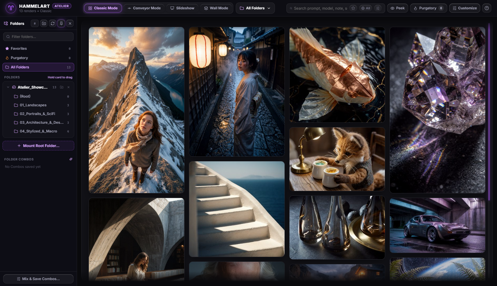
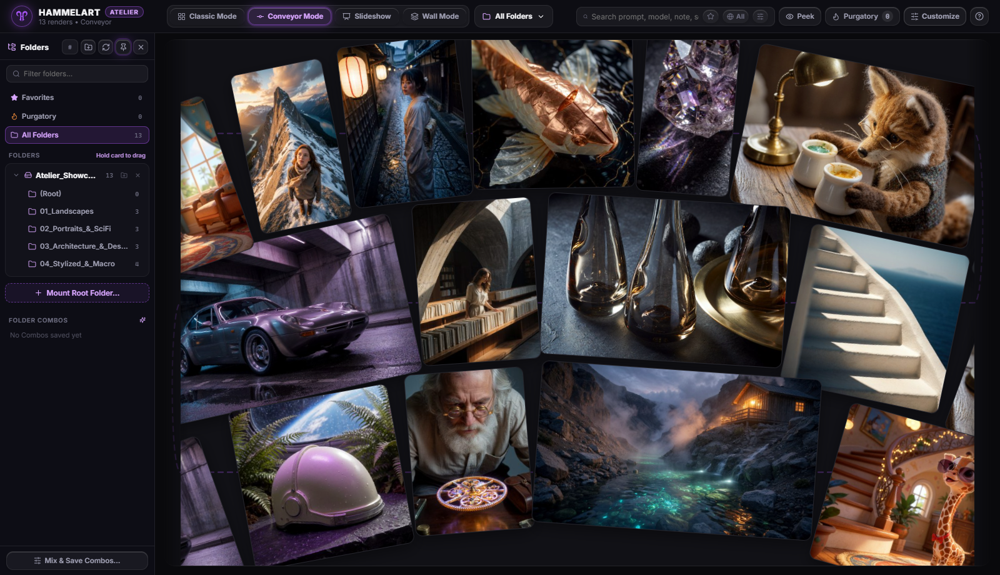
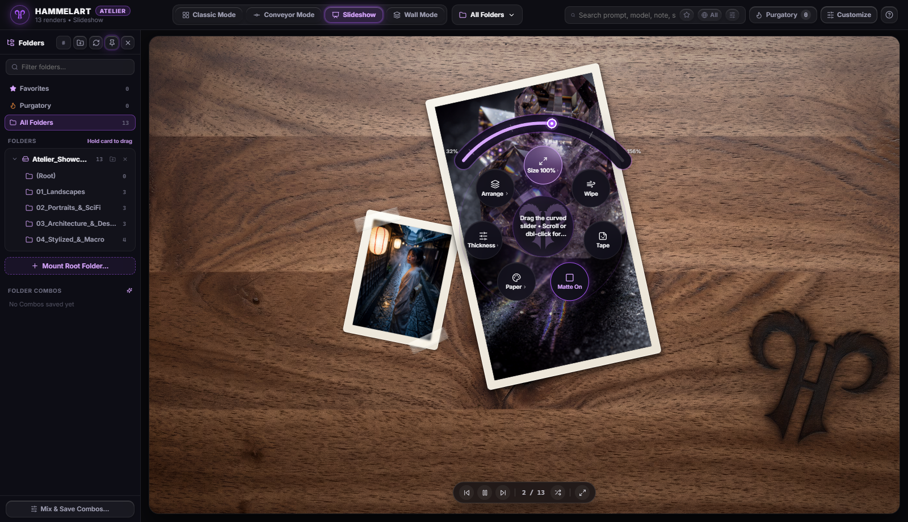
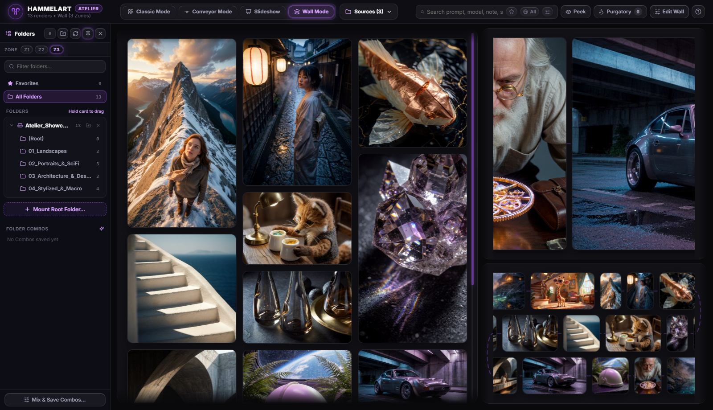
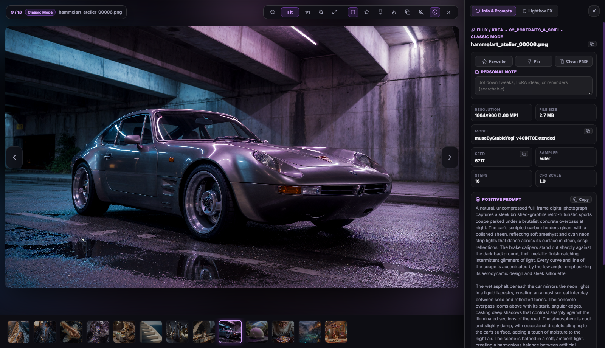
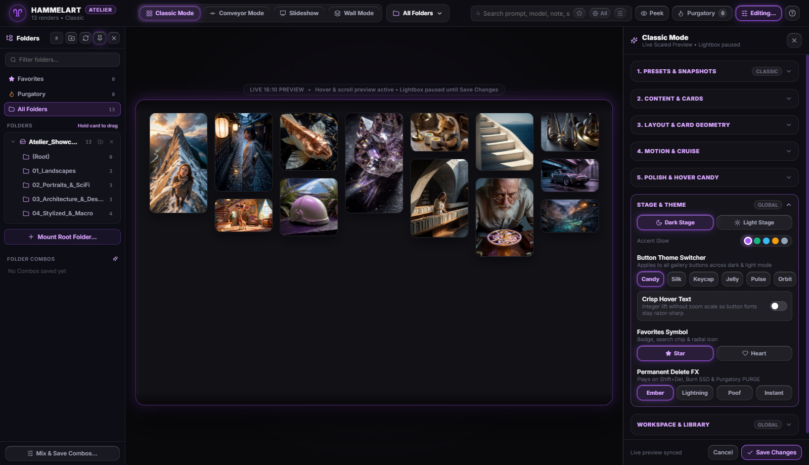
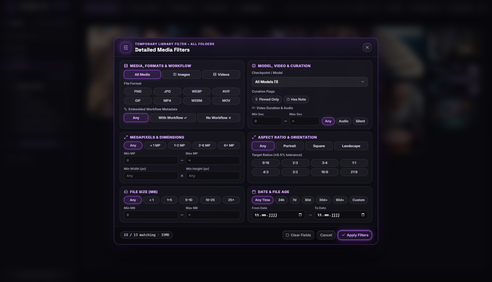

# HammelArt Atelier

> A tactile, high-craft dark-studio visual gallery, organizer, and showcase workbench for local image & video folders — running as a **standalone borderless Windows Desktop app** (Edge WebView2) or directly in your **Web Browser**, with zero external tool dependencies.



---

## Highlights

- **Five Distinct Display Modes:** Switch instantaneously between **Classic Grid**, **Conveyor Streams**, timed **Slideshow**, interactive **Table Pile Collage Desk**, and resizable **Multi-Zone Wall (`Z1..ZN`)**.
- **True Borderless Monitor Fullscreen & Idle Screensaver:** Both the Desktop window (`pywebview` / Win32) and Browser mode expand cleanly edge-to-edge without titlebars or taskbars across Slideshow, Table Pile, Lightbox, and Idle Screensaver — while keeping full drag/fling/inspect controls active in manual fullscreen.
- **Tactile Radial Context Wheel & Curved Arc Slider:** Right-click cards, folders, stages, or Lightbox views for rapid contextual controls — including a theme-tinted curved SVG arc slider (`32% – 156%`) for scaling individual collage prints live.
- **Multi-Root Organizer & Hold-to-Drag:** Mount multiple libraries across drives, save Folder Combos, hide folders non-destructively, toggle count vs disk-size readouts, hold-drag tiles straight into folders, or drop files in from Windows Explorer.
- **Two-Tier Safe Purgatory & 120fps FX:** Stage rejects safely inside Purgatory (`X` / `Del`), rescue anytime, or permanently remove via configurable deletion effects (`Ember`, `Lightning`, `Poof`, `Instant`).
- **Fast Search & Detailed Media Filters:** Instant keyword, prompt, model, note, and curation search backed by a deep multi-facet filter modal.
- **100% Isolated Personal Storage (`userdata/`):** Mounted folders, thumbnails, favorites, pins, notes, presets, themes, and window state stay strictly inside the gitignored `userdata/` folder — leaving your source media folders untouched and `git pull` updates completely safe.

---

## Display Modes & Studio Tools

### 1. Classic Grid Explorer
Structured high-speed masonry/grid browsing with instant `Ctrl + Wheel` density scaling, hover previews, quick multi-select (`Ctrl` / `Shift`), and hold-to-drag sorting into the folder tree.

### 2. Conveyor Streams
Continuous multi-lane streaming belts (horizontal or vertical) with adjustable flow speed, curve bend, paired item alignment, Seam Split transitions, focus pause, and hover/click inspection.



### 3. Table Pile & Trophy Collage Workshop
An interactive 2.5D oak desk physics stage where prints land organically with varied throw weight and slide friction nudging underlying sheets:
- **Grab, Fling & Tilt:** Pick up unpinned prints with your cursor, fling them across the desk, or scroll (`Wheel`) while hovering/dragging to rotate angles precisely.
- **Tape Trophies & Curved Arc Resizing:** Right-click any print → **Size** (`32% – 156%` curved SVG arc slider with scroll & double-click reset to `100%`) and **Tape** it permanently onto the desk. Taped miniature prints persist across reloads and folder switches, stay locked in place on your collage, and remain single-click inspectable into full-res Lightbox.



### 4. Multi-Zone Wall (`Z1..ZN`)
Split your canvas into independent live zones with draggable dividers, Blueprint split/swap handles, and per-zone sources, modes, and `Ctrl + Wheel` density controls.



### 5. Deep Lightbox & Metadata Inspector
Smooth cursor-centered zoom & pan, native `1:1` pixel toggle, video scrubbing/mute/fullscreen, collapsible thumbnail filmstrip, search-ready Personal Notes, clean metadata-stripped PNG copy, embedded AI generation prompt/checkpoint/sampler parsing, and radial context controls.



### 6. Live Customization & Themes
Open **Customize** (or **Edit Wall** in Wall Mode) for a real-time 16:10 scaled preview with Dark/Light stages, Accent Glow swatches, Button Styles (`Candy`, `Silk`, `Keycap`, `Jelly`, `Pulse`, `Orbit`), custom Favorites symbols, deletion FX, and per-mode presets.



### 7. Detailed Media Filters & Purgatory
Slice large libraries in milliseconds by media type, file extension (`PNG`, `JPG`, `WEBP`, `AVIF`, `GIF`, `MP4`, `WEBM`, `MOV`), embedded workflow metadata presence, checkpoint/model, curated pins/notes, megapixels, exact pixel dimensions, aspect ratios, file size (`MB`), and file age.



---

## Keyboard & Mouse Controls

> You can also open the searchable built-in cheat sheet & Spotlight UI Tour anytime via **`?`** in the top-right bar.

### Gallery Stage (`Classic` · `Conveyor` · `Wall` · `Purgatory`)
| Input | Action |
| :--- | :--- |
| `Ctrl` + `Wheel` | Zoom card density (Columns / Lanes / hovered Wall Zone) |
| `Hold V` | Peek filenames & metadata badges across all visible tiles |
| `F` | Toggle Favorite on selected or hovered cards |
| `Ctrl` + `A` | Select all visible cards (or active Wall Zone) |
| `Ctrl` + `Click` / `Shift` + `Click` | Add/remove selection / range-select cards |
| `Hold Drag` | Drag selected cards into any Folder Tree entry or Purgatory (`Ctrl` = Copy, `Shift` = Move, `Esc` = Cancel) |
| `X` / `Del` | Send to Purgatory (or Rescue inside Purgatory); add `Shift` to Burn permanently |
| `Right-Click` | Open Context Radial Wheel (card or stage) |
| `Esc` | Clear multi-selection or close active modal |

### Table Pile, Slideshow & Wall
| Input | Action |
| :--- | :--- |
| `←` / `→` or `A` / `D` | Step Previous / Next slide when hovered, active, or fullscreen |
| `Space` | Pause / Resume auto-advancing |
| `Wheel` *(Table Pile)* | Rotate unpinned print angle gently while hovering or dragging |
| `Grab & Fling` *(Table Pile)* | Toss unpinned prints physically across the desk |
| `Left-Click` *(Taped Print)* | Inspect taped trophy in full-res Lightbox without shifting your collage |
| `Maximize` / `F11` | Enter / Exit borderless Fullscreen Showcase (`Esc` exits cleanly) |

### Lightbox Viewer
| Input | Action |
| :--- | :--- |
| `←` / `→` or `A` / `D` | Previous / Next render in active folder or taped trophy deck |
| `Wheel` / `Dbl-Click Image` | Cursor zoom & pan when zoomed |
| `0` / `1` | Fit to viewport (`0`) or crisp `1:1` native pixels (`1`) |
| `Space` / `M` / `Dbl-Click Video` | Play/Pause · Mute/Unmute · Toggle monitor fullscreen (videos) |
| `I` / `H` | Toggle Info & Prompts Inspector (`I`) or Pure View hide HUD (`H`) |
| `F` / `X` / `Del` | Favorite (`F`) · Purgatory (`X`/`Del`) · Burn (`+ Shift`) |
| `Right-Click` | Open Lightbox Radial Menu |
| `Esc` | Exit fullscreen first, or close Lightbox |

---

## Quick Start (Windows)

### 1. Download or Clone
```bash
git clone https://github.com/HammelArt/HammelArt-Atelier.git
```
*(Or download and extract the release ZIP archive anywhere you like.)*

### 2. Launch (No Manual Python or Node Setup Needed)
Double-click any launcher inside the app folder:
- **`Launch_HammelArt_Desktop.bat`** — Opens HammelArt Atelier in a standalone native Windows app window.
- **`Launch_HammelArt_Browser.bat`** — Starts the local server and opens the interface in your default web browser.
- **`Create_Desktop_Shortcut.bat`** — Creates a Desktop shortcut (`Launch_HammelArt_Desktop.vbs`) for silent 1-click launching without a console window.

On **first launch**, **`Setup_HammelArt.bat`** automatically downloads an isolated portable Python runtime (`~10 MB` Python base + `~230 MB` unpacked packages into `python_runtime/`) once — completely sandboxed from your Windows Python environment. Built frontend assets (`dist/`) are included, so no Node.js install is required to run.

When the **Welcome Guide** appears on launch, switch to **02 First Root Folder** to mount your media directory (or take the built-in Spotlight Tour).

---

## Safe Updates & Private Data (`userdata/`)

Run **`Update_HammelArt.bat`** (or `git pull --ff-only`) inside the folder whenever updating to a newer release.

Everything personal is stored strictly inside the gitignored **`userdata/`** folder:
- `userdata/roots_config.json` — Mounted media folders & active root
- `userdata/ui_session.json` — Presets, themes, Table Pile taped prints, notes & UI state
- `userdata/cache/` — Non-destructive index caches, multi-resolution thumbnails, favorites & hidden flags
- `userdata/desktop_window_state.json` & `userdata/webview_profile/` — Standalone window bounds & WebView profile

Nothing is written into your image/video directories (except intentional moves, copies, or deletions you trigger), and Git updates never overwrite `userdata/`.

---

## Developer Build (Optional UI Editing)

If modifying frontend files under `src/`:
```bash
npm install
npm run build
```
Backend entry points:
- [`fx_server.py`](fx_server.py) — Local aiohttp media API, incremental scanner (`backend/indexer.py`), metadata parser (`backend/metadata_engine.py`), and static `dist/` host.
- [`app_desktop.py`](app_desktop.py) — Edge WebView2 desktop shell, Win32 dark titlebar theming, saved window bounds, and true borderless monitor fullscreen bridge.

---

## License

Copyright © 2026 HammelArt.  
Released under the **[GNU General Public License v3.0 (GPL-3.0)](LICENSE)**.

